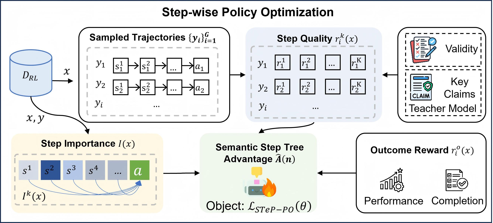

# ProcessLight

Official code for *EMNLP 2026* paper: [ProcessLight: ProcessLight: Process Supervision for Large Language Model Based Traffic Signal Control](./assets/processlight.pdf)

<p align="center">


[](./assets/processlight.pdf)

</p>

We decompose traffic signal decisions into interpretable CoT reasoning steps, build a semantic step tree to evaluate both step‑level reasoning quality and step importance within long thought chains, and implement segment‑level advantage assignment for fine‑grained policy learning. Tested on five public real‑world datasets, STeP‑PO achieves superior performance over vanilla GRPO and competing baselines.


**Figure 1. ProcessLight and STeP-PO framework.**



## Quick Start

Create a Python environment:

```bash
uv venv --prompt processlight --python 3.10
source .venv/bin/activate
```

Install the project dependencies:

```bash
uv pip install -r requirements.txt
uv pip install -e .
```

Install CityFlow separately and make sure the Python package can be imported:

```bash
git clone https://github.com/cityflow-project/CityFlow.git
cd CityFlow
uv pip install -e .
cd ..
```

Install `verl` and apply the ProcessLight patch:

```bash
git clone https://github.com/verl-project/verl.git
cd verl && git checkout v0.8.0.dev 
git apply ../patches/verl-processlight.patch
uv pip install -e .
cd ..
```

For LLM-based simulation, provide an OpenAI-compatible endpoint:

```bash
export OPENAI_API_KEY=your_api_key
export OPENAI_BASE_URL=http://localhost:8000/v1
```

## Run ProcessLight Simulation

ProcessLight simulation uses CityFlow roadnet and flow files, calls an OpenAI-compatible LLM endpoint, and writes per-intersection action logs under the configured working directory.

Create `run_processlight_sim.py`:

```python
import asyncio
import os

from rltsc.atlm.configs import CityFlowConfig, LLMConfig, SimulatorConfig
from rltsc.process.prosimulator import ProSimulateWrapper


async def main():
    cityflow_config = CityFlowConfig(
        interval=1.0,
        seed=42,
        dir="outputs/processlight_sim",
        roadnetFile="datasets/hangzhou/roadnet_4_4.json",
        flowFile="datasets/hangzhou/hangzhou1.json",
        rlTrafficLight=True,
        saveReplay=False,
    )

    simulator_config = SimulatorConfig(
        phase_list_type="four",
        max_simulation_seconds=3600,
        fixed_phase_duration=20.0,
        save_snapshot=False,
        strategy_params={
            "density_capacity_vehicle_length": 9.0,
            "llm_max_retries": 3,
            "history_window": 4,
        },
    )

    llm_config = LLMConfig(
        llm_base_url=os.environ["OPENAI_BASE_URL"],
        llm_api_key=os.environ["OPENAI_API_KEY"],
        llm_model_name="deepseek-v4-pro",
    )

    simulator = ProSimulateWrapper(
        cityflow_config=cityflow_config,
        simulator_config=simulator_config,
        traj_name="hangzhou1_processlight",
        llm_config=llm_config,
        save_snapshot=False,
    )

    metrics, logs = await simulator.run_simulation()
    print(metrics)
    print(f"num_intersections={len(logs)}")


if __name__ == "__main__":
    asyncio.run(main())
```

Run:

```bash
python run_processlight_sim.py
```

The main output is:

```text
outputs/processlight_sim/action_logs/*_action_log.json
outputs/processlight_sim/processlight.log
```

## Prepare Training Data

The trainer expects fixed ProcessLight JSON files and converts them into `verl` parquet files.

Prepare SFT data:

```bash
python -m rltsc.trainer.prepare_data sft \
  --input datasets/process/process_sft_1k.json \
  --output datasets/process/process_sft_1k.parquet
```

Prepare GRPO data:

```bash
python -m rltsc.trainer.prepare_data grpo \
  --input datasets/process/process_grpo_2k.json \
  --output datasets/process/process_grpo_2k.parquet
```

The GRPO JSON rows must contain `prompt`, `solution`, `extra_info`, and `extra_info.prompt_state_dict`. `prompt_state_dict` is validated by `src/rltsc/processlight_contract.py` before writing parquet.

## Supervised Fine-Tuning

Run SFT with the ProcessLight SFT config:

```bash
python -m rltsc.trainer.train_sft \
  data.train_files=datasets/process/process_sft_1k.parquet \
  data.val_files=datasets/process/process_sft_1k.parquet \
  model.partial_pretrain=Qwen/Qwen2.5-3B-Instruct \
  trainer.default_local_dir=outputs/sft_processlight
```

Adjust model path, batch size, tensor parallel size, and output directory in `src/rltsc/trainer/configs/sft.yaml` or by Hydra command-line overrides.

## Step-Wise GRPO Training

Run STeP-PO / ProcessLight GRPO:

```bash
python -m rltsc.trainer.train_grpo \
  data.train_files=datasets/process/process_grpo_2k.parquet \
  data.val_files=datasets/process/process_grpo_2k.parquet \
  actor_rollout_ref.model.path=outputs/sft_processlight \
  trainer.default_local_dir=outputs/grpo_processlight
```

The GRPO config uses:

```yaml
algorithm:
  adv_estimator: processlight_tree
  processlight:
    eta: 0.3
    lambda_step: 0.3
    format_coef: 0.8
    use_tree: True
    use_importance: True
    use_step_quality: True
```

The reward path is:

`src/rltsc/trainer/reward_manager.py` calls `src/rltsc/trainer/rewards.py`, which parses ProcessLight reasoning, verifies step claims through `src/rltsc/verify/`, computes step quality, and exposes token spans for step-level advantage assignment.

The advantage path is:

`src/rltsc/trainer/advantage.py` registers `processlight_tree`, reads step quality and step importance from the rollout batch, builds semantic step-tree advantages, and writes token-level advantages back to `verl`.

## License

- [MIT](LICENSE)


## Citation

```bib
@misc{zhao2026processlight,
      title={ProcessLight: ProcessLight: Process Supervision for Large Language Model Based Traffic Signal Control}, 
      author={Shuaitao Zhao and TianlongZhou and Weijie Wang and Jiasheng Shi and Weixiong Rao},
      year={2026},
      url={https://github.com/wenzhaoabc}
}
```
